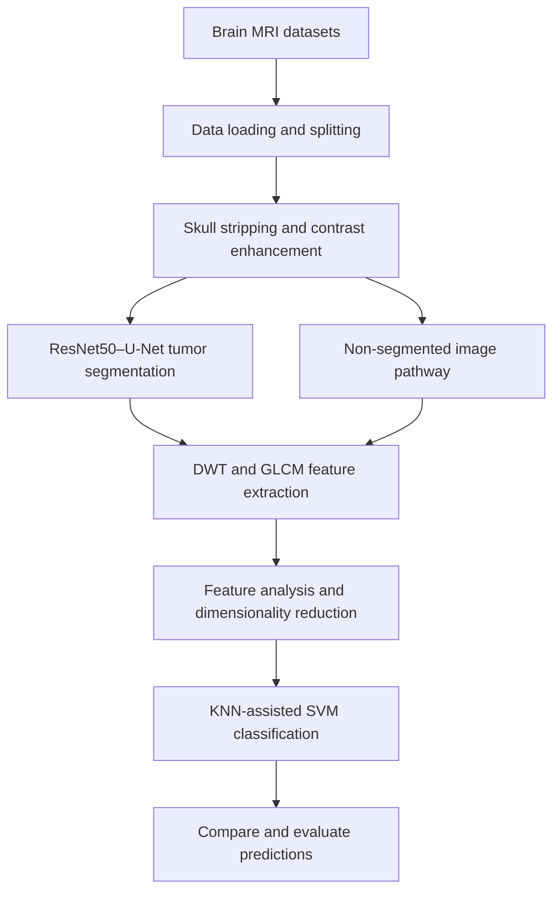

# MRI-Based Multi-Class Brain Tumor Classification

**An end-to-end AI/ML research workflow for brain MRI preprocessing, tumor segmentation, feature engineering, and classification.**


## Overview

This project explores an AI-driven framework for analyzing brain MRI scans and classifying brain tumors. It brings together conventional image-processing techniques, **ResNet50–U-Net-based tumor segmentation**, handcrafted feature extraction, dimensionality reduction, and an **SVM-based classification approach assisted by K-nearest-neighbor (KNN) methods**.

The goal is to investigate how preprocessing and segmentation can support feature-based classification. The repository is organized as a series of Jupyter notebooks documenting different stages of the workflow.

### Key technical highlights

- **MRI preprocessing:** brain extraction/skull stripping and contrast enhancement to prepare scans for analysis.
- **Deep learning model development:** ResNet50–U-Net architecture for pixel-level brain tumor segmentation.
- **Feature engineering:** Discrete Wavelet Transform (DWT) and Gray-Level Co-occurrence Matrix (GLCM) to characterize frequency and texture patterns.
- **Classification pipeline:** dimensionality reduction/exploration with t-SNE and a KNN-assisted SVM approach, including an investigation of classification with and without segmentation.
- **Research workflow:** dataset access, splitting, preprocessing, segmentation, feature extraction, and classification documented in separate notebooks.

## End-to-end workflow



> **Note:** This diagram summarizes the workflow described in the original project documentation. Exact dataset paths, processing order, and intermediate files depend on the notebooks and your local environment.

## Datasets

The project documentation describes the following research datasets:

| Dataset | Size described in the original project | MRI modalities | Target categories described in the project |
| --- | --- | --- | --- |
| **VASARI MRI** | 60 patients | T1, T2, FLAIR, T1-CE | Astrocytoma, oligodendroglioma, glioblastoma multiforme |
| **BraTS 2019** | 335 patients | T1, T2, FLAIR, T1-CE | High-grade glioma (HGG), low-grade glioma (LGG) |

The datasets serve related but **not identical** labeling tasks. Dataset-specific preparation and label mapping should be checked before training or comparing classification results. The source MRI datasets are **not included in this repository**.

## Methodology

### 1. MRI preprocessing

Prepare MRI images for downstream analysis by separating relevant brain tissue from surrounding structures and enhancing useful visual contrast.

- **Skull stripping:** Brain Extraction Tool (BET), as described in the project documentation.
- **Contrast enhancement:** histogram-based enhancement to improve visibility of anatomical and tumor regions.
- **Data preparation:** load, organize, and split the available MRI data.

**Relevant notebooks:** [`AccessData.ipynb`](./AccessData.ipynb), [`DataSplit.ipynb`](./DataSplit.ipynb), [`ProcessingBraTSandContrastEnhancement.ipynb`](./ProcessingBraTSandContrastEnhancement.ipynb).

### 2. Brain tumor segmentation — ResNet50–U-Net

The segmentation stage uses a **ResNet50 encoder combined with a U-Net-style decoder**. The architecture brings together deep feature extraction and spatially detailed segmentation to produce pixel-level region predictions. The original project documentation describes the ResNet50 encoder as ImageNet-pretrained.

**Relevant notebook:** [`ResNet50UNetipynb.ipynb`](./ResNet50UNetipynb.ipynb).

### 3. Feature extraction and dimensionality reduction

The feature-based analysis uses:

| Technique | Purpose |
| --- | --- |
| **DWT — Discrete Wavelet Transform** | Capture image information at multiple frequency scales |
| **GLCM — Gray-Level Co-occurrence Matrix** | Describe texture and spatial gray-level relationships |
| **t-SNE — t-distributed Stochastic Neighbor Embedding** | Explore lower-dimensional representations of extracted features |

> **Technical note:** t-SNE is primarily an exploratory embedding method. Any use of embeddings as classifier inputs needs careful train/test isolation and evaluation to avoid data leakage.

### 4. Multi-class classification

The final stage investigates an **SVM-based tumor classifier with KNN-assisted processing**, as described in the original project README. The documented methodology considers classification **with and without prior segmentation**, allowing the effect of the segmentation stage on downstream classification to be explored.

**Relevant notebook:** [`FeatureExtractionReductionClassification.ipynb`](./FeatureExtractionReductionClassification.ipynb).

## Repository structure

```text
Multi-Class-Brain-Tumor-Classification-/
├── AccessData.ipynb
├── DataSplit.ipynb
├── ProcessingBraTSandContrastEnhancement.ipynb
├── ResNet50UNetipynb.ipynb
├── FeatureExtractionReductionClassification.ipynb
├── .gitattributes
└── README.md
```

| Notebook | What it covers |
| --- | --- |
| [`AccessData.ipynb`](./AccessData.ipynb) | Accessing and preparing MRI data |
| [`DataSplit.ipynb`](./DataSplit.ipynb) | Organizing data splits |
| [`ProcessingBraTSandContrastEnhancement.ipynb`](./ProcessingBraTSandContrastEnhancement.ipynb) | BraTS preprocessing and contrast enhancement |
| [`ResNet50UNetipynb.ipynb`](./ResNet50UNetipynb.ipynb) | ResNet50–U-Net segmentation model |
| [`FeatureExtractionReductionClassification.ipynb`](./FeatureExtractionReductionClassification.ipynb) | Feature extraction, dimensionality reduction, and classification |

## Getting started

### Prerequisites

- Python 3 and Jupyter Notebook or JupyterLab
- Access to the research MRI datasets and sufficient storage for volumetric images
- Packages needed by the notebook imports (see each notebook for its exact dependencies)
- A GPU-enabled environment is recommended for deep learning experiments
- **Git LFS** to retrieve notebook files stored as large-file objects

### 1. Clone the repository

```bash
git clone https://github.com/NiranjanaSunish/Multi-Class-Brain-Tumor-Classification-.git
cd Multi-Class-Brain-Tumor-Classification-
git lfs install
git lfs pull
```

### 2. Create a Python environment

```bash
python -m venv .venv
# On Windows:
.venv\Scripts\activate
# On macOS/Linux:
# source .venv/bin/activate
python -m pip install --upgrade pip
python -m pip install notebook
```

> **Dependency status:** The repository does not currently contain a verified `requirements.txt` or locked environment. Install the libraries imported by the notebooks, using compatible versions. A pinned environment file is a recommended next improvement.

### 3. Obtain and configure the datasets

Download the authorized VASARI/BraTS data separately and update the notebook data paths to match your local layout. Check data-use terms and keep any restricted medical images outside the public repository.

### 4. Explore the notebooks

```bash
jupyter notebook
```

A useful **reading order** is:

1. `AccessData.ipynb`
2. `DataSplit.ipynb`
3. `ProcessingBraTSandContrastEnhancement.ipynb`
4. `ResNet50UNetipynb.ipynb`
5. `FeatureExtractionReductionClassification.ipynb`

This is a navigation guide, **not a claim that the notebooks form a one-click, fully reproducible pipeline**. Verify each notebook's inputs, outputs, and paths before executing it.

## Evaluation and results

The project investigates both tumor segmentation and tumor-type classification. Useful evaluation measures for documenting these experiments include:

| Task | Recommended evaluation | Results |
| --- | --- | --- |
| Segmentation | Dice score, Intersection over Union (IoU), qualitative mask overlays | Add verified results from completed experiments |
| Classification | Accuracy, macro precision, macro recall, macro F1-score | Add verified results from completed experiments |
| Error analysis | Confusion matrix and per-class performance | Add plots from held-out evaluation |
| Pipeline comparison | Performance with versus without segmentation | Add paired results using equivalent data splits |

**No numerical performance claims are included here because the existing public README does not report verified scores.** Once available, add the test-set metrics, dataset and split details, and visual results exported from the notebooks. Avoid presenting training accuracy as held-out test accuracy.

## Reproducibility and limitations

- The repository contains **research notebooks**, not a deployed clinical application or packaged inference API.
- The datasets are external and may have access conditions; paths and software versions may require adjustment.
- Label sets differ between the documented datasets; comparisons must respect their definitions.
- Evaluation should use patient-level separation where applicable to reduce train/test leakage.
- MRI models may not generalize across scanners, hospitals, acquisition protocols, or patient populations without external validation.
- **This project is for research and educational purposes only and must not be used for medical diagnosis or treatment decisions.**

## Future improvements

- Publish pinned dependencies and a complete reproducibility guide.
- Include evaluation plots, example predictions, and verified model metrics.
- Document preprocessing parameters, data splits, model configuration, and random seeds.
- Add systematic comparisons between segmentation-assisted and direct classification.
- Package trained-model inference into a small demonstrator, subject to appropriate data handling and model-validation safeguards.

## Author

**[NiranjanaSunish](https://github.com/NiranjanaSunish)**  
AI / Machine Learning · Computer Vision · Medical Image Analysis

---

*This repository demonstrates the design and experimentation involved in combining classical image analysis and machine learning with deep learning-based segmentation for MRI research.*
