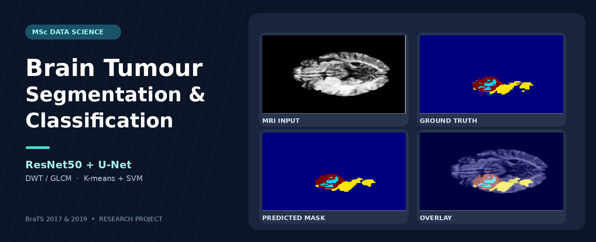
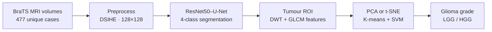
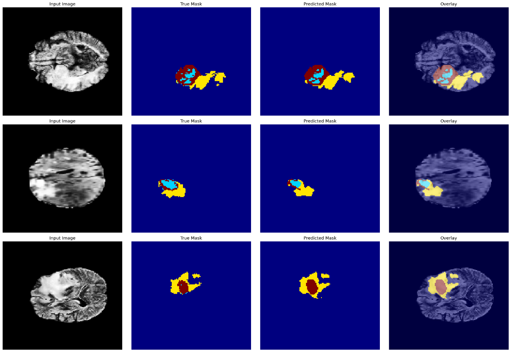
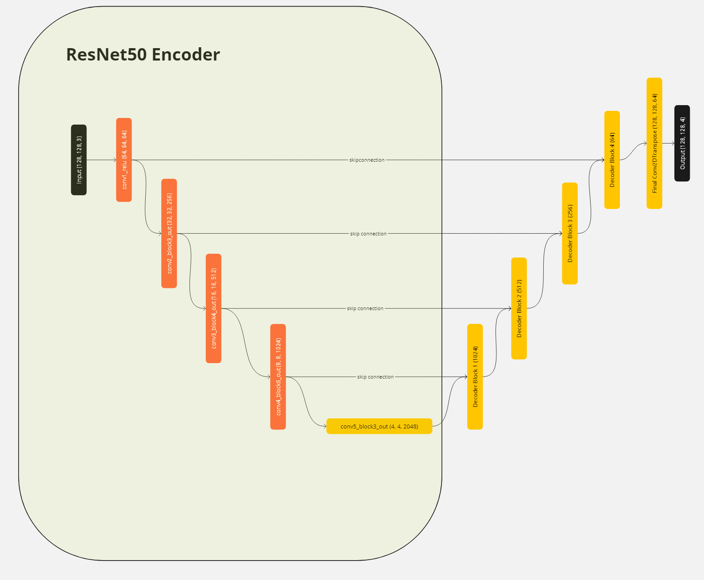
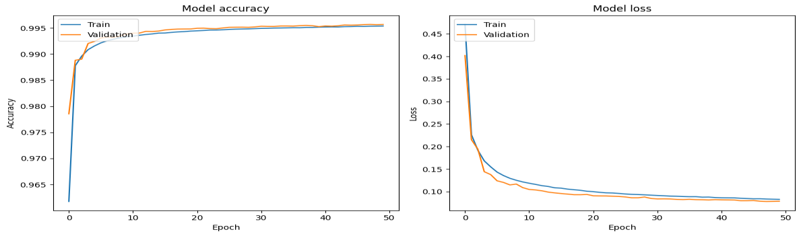
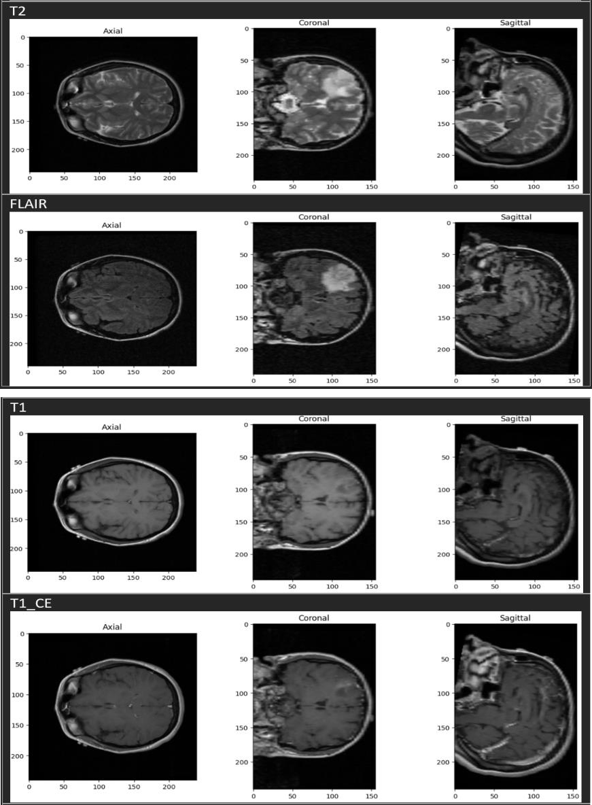
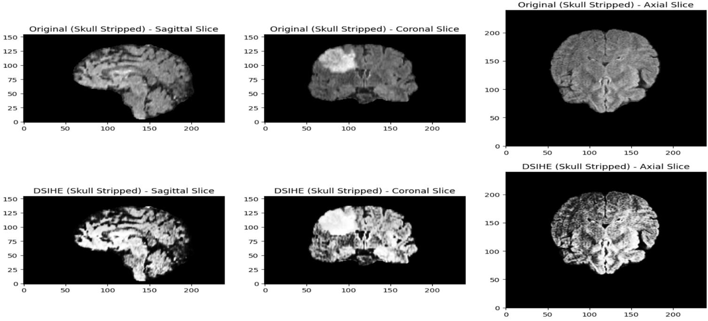

<div align="center">

# 🧠 Brain Tumour Segmentation & Glioma Classification

**MRI-based AI research · Deep learning · Medical image analysis · Machine learning**





</div>

## Project overview

An **end-to-end MRI analysis framework** that first segments brain tumour tissue with a **ResNet50–U-Net** neural network, then uses features from the predicted tumour regions to distinguish **low-grade (LGG)** from **high-grade (HGG)** gliomas.

This is my **MSc Data Science dissertation project at the University of Birmingham (2023–24)**. It covers the full model-development lifecycle—from preparing 3D medical scans to training, hyperparameter tuning, evaluating predictions, and comparing feature-reduction approaches.

### Key results

| Segmentation test accuracy | Segmentation test Dice score | Segmentation test mIoU | Best LGG/HGG classification CV accuracy |
| :---: | :---: | :---: | :---: |
| **99.14%** | **0.8127** | **0.9271** | **91.61%** |

> **Evaluation context:** The segmentation numbers are **test-set metrics**. The 91.61% classification result is the **best reported 5-fold cross-validation accuracy**, not a held-out test score. All values are taken from the dissertation; this repository does not independently re-run the experiments.

### What I developed

- **MRI preprocessing:** patient deduplication, volume handling, slice selection, image resizing and comparison of CLAHE versus DSIHE contrast enhancement.
- **Deep learning model:** an ImageNet-pretrained **ResNet50 encoder** connected to a custom **U-Net decoder** for four-class tumour-region segmentation.
- **Feature engineering:** tumour ROI extraction, **DWT** sub-band decomposition and **GLCM** texture descriptors.
- **ML classification:** comparison of **PCA versus t-SNE**, followed by **K-means + SVM**, parameter tuning and cross-validation for LGG/HGG classification.

## Technical approach



| Stage | Design choices |
| --- | --- |
| **Data** | BraTS 2017 + BraTS 2019 training sets; **477 unique patient cases** after deduplication; 3D NIfTI volumes (**240 × 240 × 155**) |
| **MRI input** | T1, T1ce, T2, FLAIR; segmentation uses **T1ce + T2 + FLAIR**, while classification uses all four modalities with segmentation masks |
| **Preprocessing** | Selected slices **60–75**, resized to **128 × 128**; **DSIHE** chosen after comparison with CLAHE |
| **Segmentation** | Frozen ImageNet-pretrained **ResNet50** encoder + custom U-Net decoder; skip connections, dropout **0.3**, four-label softmax output |
| **Training** | **Adam**, combined **Dice + focal loss**, **50 epochs**, **batch size 64** |
| **Feature engineering** | ROI across axial/coronal/sagittal views; **db1 DWT** frequency sub-bands and **GLCM** texture descriptors |
| **Classification** | PCA/t-SNE comparison (**2 retained dimensions**), **K-means clustering + RBF SVM**, parameter search |

**Segmentation label mapping:** `0` = background; `1` = necrotic/non-enhancing tumour core; `2` = edema; `4` = enhancing tumour. *Four segmentation labels are not the same as four tumour types.* The final glioma-grade task is **binary (LGG/HGG)**.

## Visual results

### 1. MRI segmentation: predictions versus ground truth



*Each row shows an MRI input, ground-truth mask, prediction and colour overlay. Examples are qualitative, not a replacement for numerical evaluation.*

### 2. Model architecture



*Frozen ResNet50 feature extraction, multi-scale skip connections and decoder reconstruction.*

### 3. Training and validation curves



*Final reported **training accuracy: 99.54%** and **validation accuracy: 99.57%**. The independent test-set accuracy is reported separately below.*

<details>
<summary><strong>More images: MRI modalities and contrast enhancement</strong></summary>

**Four MRI modalities (T2, FLAIR, T1, T1ce)**



**DSIHE contrast enhancement**



*DSIHE was chosen over CLAHE based on the visual comparison reported in the study.*

</details>

## Results

### Segmentation: held-out test evaluation

| Metric | Reported result |
| --- | ---: |
| **Pixel accuracy** | **99.14%** |
| **Overall Dice coefficient** | **0.8127** |
| **Mean intersection over union (mIoU)** | **0.9271** |

The study also reports region-specific evaluation values:

| Region | Dice score | Hausdorff distance | Sensitivity |
| --- | ---: | ---: | ---: |
| Enhancing tumour (ET) | 0.8935 | 34.2199 | 0.9156 |
| Tumour core (TC) | 0.8900 | 32.0156 | 0.8730 |
| **Whole tumour (WT)** | **0.9511** | **23.6220** | **0.9425** |

*Source: dissertation Table 2 and Table 3, p. 27. These aggregate and region-specific scores are reported separately in the source; they should not be treated as interchangeable.*

### Classification: PCA versus t-SNE

| Feature reduction | Best reported 5-fold CV accuracy | K-means clusters | SVM configuration |
| --- | ---: | ---: | --- |
| PCA | 79.23% | 3 | RBF, `C=1`, `gamma=auto` |
| **t-SNE** | **91.61%** | **5** | RBF, `C=1`, `gamma=auto` |

In the experiments reported, **t-SNE outperformed PCA** as the two-dimensional feature representation for the K-means + SVM classification workflow. *Source: dissertation pp. 28–29.*

## Explore the code

The repository is organized as a series of research notebooks. The following names are taken from the previous repository inventory; if a file has been renamed, update its link before publishing.

| Notebook | What it covers |
| --- | --- |
| [`AccessData.ipynb`](./AccessData.ipynb) | Loading BraTS MRI volumes |
| [`DataSplit.ipynb`](./DataSplit.ipynb) | Data splitting and preparation |
| [`ProcessingBraTSandContrastEnhancement.ipynb`](./ProcessingBraTSandContrastEnhancement.ipynb) | MRI preprocessing and DSIHE comparison |
| [`ResNet50UNetipynb.ipynb`](./ResNet50UNetipynb.ipynb) | Model architecture, training and segmentation evaluation |
| [`FeatureExtractionReductionClassification.ipynb`](./FeatureExtractionReductionClassification.ipynb) | DWT/GLCM features, PCA/t-SNE, K-means and SVM |

## Getting started

1. **Clone the repository** and retrieve the notebook content tracked in Git LFS, if applicable:

   ```bash
   git clone https://github.com/NiranjanaSunish/Multi-Class-Brain-Tumor-Classification-.git
   cd Multi-Class-Brain-Tumor-Classification-
   git lfs install
   git lfs pull
   ```

2. **Prepare a Python/Jupyter environment.** Install the dependencies imported by the notebooks, with versions compatible with your environment. A verified, pinned `requirements.txt` is not currently supplied in this README.
3. **Obtain BraTS 2017/2019 datasets** in accordance with their data-access requirements and update the local paths in the notebooks. The datasets are not packaged here.
4. **Explore the notebooks** in pipeline order: data access → preprocessing → segmentation → feature extraction → classification. The notebooks may require dataset-specific paths and substantial compute resources.

> **Research reproducibility:** The reported results come from the dissertation. Trained weights, random seeds, environment versions, a complete inference script and independent rerun are not verified here. Do not interpret this as a ready-to-deploy diagnostic application.

## Limitations & future work

- **Data generalizability:** 477 unique patient cases may not represent all tumour presentations or MRI acquisition settings.
- **Spatial information:** restricting the data to slices 60–75 and resizing to 128 × 128 may lose clinically relevant details.
- **Regional segmentation:** ET and TC achieved lower reported Dice scores than whole-tumour segmentation.
- **Evaluation transparency:** future work should explicitly validate patient-level separation and out-of-fold fitting of feature transformations—especially t-SNE—to establish robust generalization.
- **Next steps:** evaluate more diverse datasets, improve the smaller-region segmentations, document a fully reproducible environment, and add a separate inference demonstration.

**Academic research only:** This work is not a clinically validated medical device and must not be used for diagnosis or treatment decisions.
