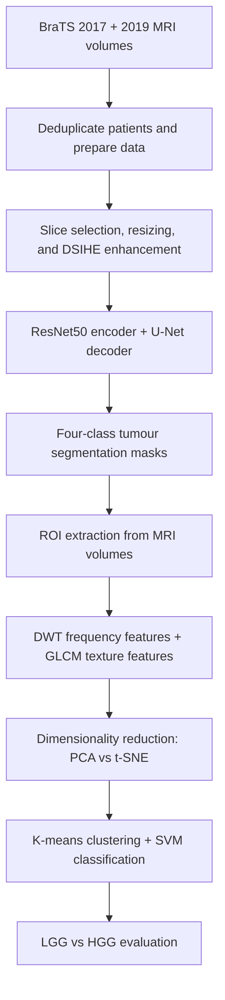

# MRI-Based Brain Tumour Segmentation & Classification

**An end-to-end AI research project combining ResNet50–U-Net segmentation, medical image processing, feature engineering, and machine learning-based glioma grade classification.**


> **MSc Data Science dissertation**, University of Birmingham, 2023–24. This repository documents a research workflow, **not a clinically validated diagnostic tool**.

## Highlights

| **99.14%** | **0.8127** | **0.9271** | **91.61%** |
| :---: | :---: | :---: | :---: |
| Segmentation **test accuracy** | Segmentation **test Dice** | Segmentation **test mean IoU** | Best classification **5-fold CV accuracy** |

**Data:** 477 unique MRI patient cases after deduplicating BraTS 2017 and 2019 training sets. **Segmentation:** four pixel labels. **Classification:** low-grade glioma (LGG) versus high-grade glioma (HGG).

**What this project demonstrates:** designing and training a deep-learning segmentation model; MRI preprocessing; extracting spatial, texture, and frequency-domain features; hyperparameter tuning; and evaluating a downstream classification pipeline.

## Segmentation results: ground truth vs prediction


*Qualitative examples from the dissertation (p. 28). Columns show input MRI, true mask, predicted mask, and overlay. These are illustrative samples, not a substitute for held-out quantitative evaluation.*

## The problem

Brain tumour regions can be difficult to delineate reliably across MRI scans because of their varied sizes, shapes, and tissue characteristics. This research explores a two-stage framework:

1. **Multi-class segmentation:** identify tumour-related pixel regions in MRI using a ResNet50 encoder and a U-Net-style decoder.
2. **Glioma grade classification:** extract discriminative features from the segmented tumour regions and classify gliomas as LGG or HGG using a K-means and support-vector-machine (SVM) pipeline.

> **Terminology:** The *segmentation* task is multi-class (background, necrotic/non-enhancing core, edema, enhancing tumour). The final *glioma grade classification* task is **binary**, not a multi-class tumour-type classifier.

## Methodology at a glance



### 1. Data preparation and MRI modalities

The project uses the **BraTS 2017 and BraTS 2019 training datasets**, retaining **477 unique patient cases** after removing duplicated patients. Scans are 3D NIfTI volumes with an original size of **240 × 240 × 155** and include **T1, T1-contrast-enhanced (T1ce), T2, and FLAIR** images, along with annotated segmentation masks.


*Multimodal brain MRI examples from the dissertation (p. 19).*

- The original BraTS mask labels are **0** (background), **1** (necrotic and non-enhancing tumour core), **2** (peritumoral edema), and **4** (enhancing tumour).
- For segmentation, the study uses **T2, T1ce, and FLAIR** modalities; the classification workflow uses **all four** MRI modalities along with predicted segmentation masks.
- The segmentation dataset was split **70% training / 30% testing**, with an additional **90% / 10% training-validation split** within the training portion, as described in the dissertation.

### 2. Preprocessing and contrast enhancement

The pipeline selects MRI slices **60–75**, resizes slices and their masks to **128 × 128**, and investigates two histogram-based contrast enhancement methods: **CLAHE** and **Dualistic Sub-Image Histogram Equalization (DSIHE)**. DSIHE was chosen after qualitative comparison in the research.


*Original versus DSIHE-enhanced MRI examples from the dissertation (p. 20).*

### 3. Deep-learning segmentation — ResNet50–U-Net

The segmentation model uses an **ImageNet-pretrained ResNet50 encoder** with frozen encoder weights and a **custom U-Net-style decoder** with skip connections to recover spatial detail. The decoder uses transposed convolutions, convolutional blocks, batch normalization, ReLU, and dropout (**0.3**). The final output is a **four-channel softmax segmentation map**.


*Segmentation architecture developed for this project (dissertation, p. 22).*

**Training configuration in the dissertation:**

| Setting | Configuration |
| --- | --- |
| Optimizer | Adam |
| Loss | Combined Dice loss and focal loss |
| Epochs | 50 |
| Batch size | 64 |
| Input size | 128 × 128 |
| Output | Four segmentation labels |

### 4. Feature extraction and dimensionality reduction

The segmentation masks define regions of interest in axial, coronal, and sagittal views. **Discrete Wavelet Transform (DWT)** with the `db1` wavelet decomposes these regions into frequency sub-bands, then **Gray-Level Co-occurrence Matrix (GLCM)** descriptors capture texture properties (contrast, dissimilarity, homogeneity, energy, correlation, and angular second moment).

The study compares **PCA** and **t-SNE**, retaining two-dimensional representations for the classification experiments.

### 5. Glioma grade classification — K-means + SVM

The downstream classifier combines **K-means clustering** with an **SVM**, using a parameter search for the number of clusters and SVM settings. The best reported t-SNE-based configuration was:

- **K-means clusters:** 5
- **SVM kernel:** RBF
- **Regularization (`C`):** 1
- **Gamma:** `auto`
- **Evaluation:** best reported **5-fold cross-validation accuracy of 91.61%**

This is **not a K-nearest-neighbors (KNN) classifier**. K-means is the unsupervised clustering component in the dissertation.

## Quantitative results

### Segmentation

| Metric | Reported test result |
| --- | ---: |
| **Pixel-level accuracy** | **99.14%** |
| **Dice coefficient** | **0.8127** |
| **Mean intersection over union (mIoU)** | **0.9271** |

**Region-specific reported segmentation metrics** (separately tabulated in the dissertation):

| Region | Dice | Hausdorff distance | Sensitivity |
| --- | ---: | ---: | ---: |
| Enhancing tumour (ET) | 0.8935 | 34.2199 | 0.9156 |
| Tumour core (TC) | 0.8900 | 32.0156 | 0.8730 |
| Whole tumour (WT) | **0.9511** | 23.6220 | 0.9425 |


*Training and validation accuracy/loss over 50 epochs (dissertation, p. 26). Training accuracy at epoch 50: 99.54%; final validation accuracy: 99.57%.*

### Classification: PCA vs t-SNE

| Dimensionality reduction | Best reported 5-fold cross-validation accuracy | K-means clusters | SVM configuration |
| --- | ---: | ---: | --- |
| PCA | 79.23% | 3 | RBF, `C=1`, `gamma=auto` |
| **t-SNE** | **91.61%** | **5** | **RBF, `C=1`, `gamma=auto`** |

These values are **as reported in the MSc dissertation** (segmentation results on pp. 26–27; classification results on pp. 28–29). They are not independently reproduced in this README. The two stages use different evaluation procedures; segmentation accuracy is **not** the same metric as Dice or mIoU.

## Repository notebooks

The project stages are documented in the following notebooks. Paths are based on the existing repository documentation; check actual filenames after cloning.

| Notebook | Focus |
| --- | --- |
| [`AccessData.ipynb`](./AccessData.ipynb) | Dataset access and loading |
| [`DataSplit.ipynb`](./DataSplit.ipynb) | Training, validation, and test preparation |
| [`ProcessingBraTSandContrastEnhancement.ipynb`](./ProcessingBraTSandContrastEnhancement.ipynb) | BraTS image processing and contrast enhancement |
| [`ResNet50UNetipynb.ipynb`](./ResNet50UNetipynb.ipynb) | ResNet50–U-Net segmentation |
| [`FeatureExtractionReductionClassification.ipynb`](./FeatureExtractionReductionClassification.ipynb) | Feature extraction, reduction, K-means and SVM classification |

### Quick start

```bash
git clone https://github.com/NiranjanaSunish/Multi-Class-Brain-Tumor-Classification-.git
cd Multi-Class-Brain-Tumor-Classification-
git lfs install
git lfs pull
python -m venv .venv
```

Activate the environment (`.venv\Scripts\activate` on Windows, or `source .venv/bin/activate` on macOS/Linux), install Jupyter and the dependencies used in the notebooks, then run:

```bash
jupyter notebook
```

The source BraTS datasets are **not included** and must be obtained separately under the applicable terms. Update local data paths in each notebook. A pinned `requirements.txt`, trained-model artifact, and one-command inference interface are **not supplied or independently verified** here; this is research notebook code rather than a turnkey application.

## Limitations and next steps

- **Dataset size:** 477 unique patient cases; independent external validation is needed for broader generalizability.
- **Slice selection/resizing:** selecting slices 60–75 and resizing to 128 × 128 may omit relevant tumour information.
- **Region differences:** enhancing tumour and tumour-core segmentation remain less robust than whole-tumour segmentation in the reported region-wise metrics.
- **Model evaluation:** to rigorously validate the classification result, ensure patient-level fold isolation and fit all feature transforms within each training fold. In particular, **t-SNE is usually an exploratory embedding tool**; its use in a predictive pipeline needs careful leakage checks and out-of-sample validation.
- **Reproducibility:** publish environment versions, dataset preprocessing scripts, sample output, and evaluation protocol when practical.

> **Medical disclaimer:** For academic research and education only. These models have not been established as safe or effective for clinical diagnosis or treatment decisions.

## About this work

**Author:** [Niranjana Sunish](https://github.com/NiranjanaSunish)  
**Qualification:** MSc Data Science, University of Birmingham (2023–24)  
**Dissertation:** *A Comprehensive AI Framework for MRI-Based Multi-Class Brain Tumour Segmentation and Classification*  
**Supervisor:** Dr. Mian Muhammad Hamayun

**Figure attribution:** All five visual assets in `assets/` were extracted from the author's supplied MSc dissertation (pp. 19, 20, 22, 26 and 28), preserving the original findings and diagrams.
